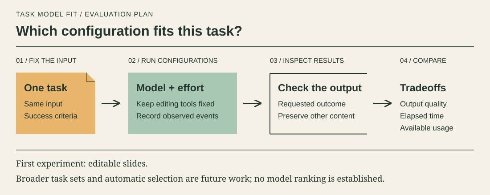

# Task Model Fit

Evaluate which model and reasoning effort fit a specific task by comparing output quality, waiting time, and available resource-usage measurements.

The aim is to make model selection evidence-based: define success for a task, compare configurations on the same input, and inspect both the requested result and unintended changes.
Slide editing is the first experiment; broader task evaluation and automatic selection are future work.

This repository starts with an initial scaffold; the starter application will be introduced through a draft pull request.
No benchmark ranking, optimal model, or resource savings have been established.
